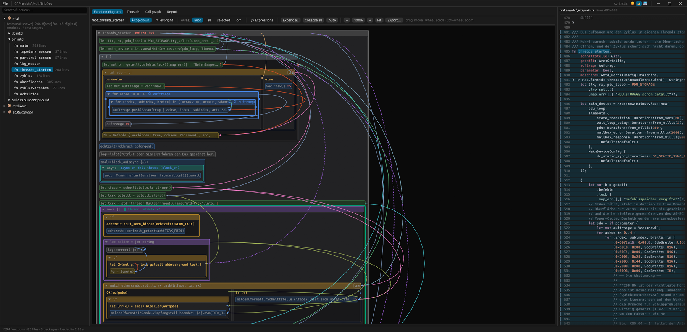
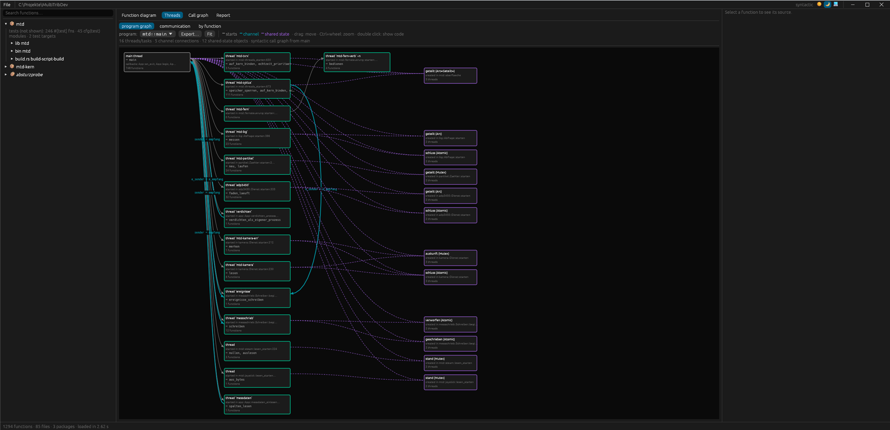
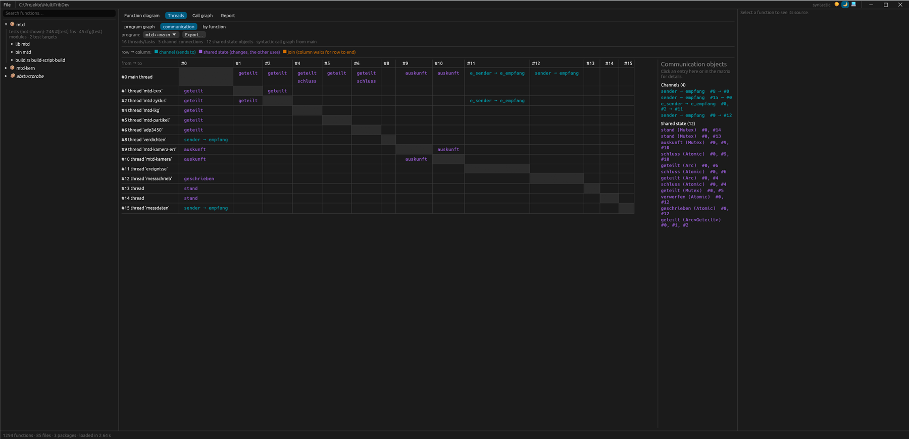
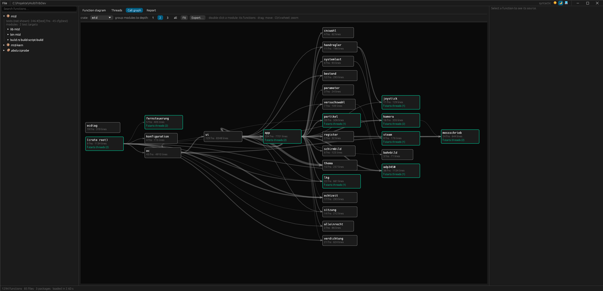
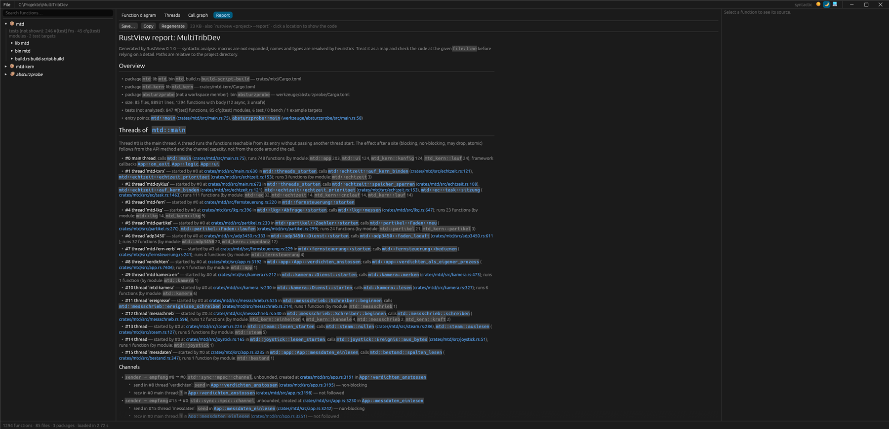

# RustView

LabVIEW-style structural view of Rust code: nesting, data flow and
parallelism of a program at a glance. Analysis and display only — no
editing, no code generation.



## Why

Rust projects grow fast — especially with LLM assistance, where a working
program with threads, channels, shared state and deeply nested control flow
can appear in an afternoon. Writing the code is no longer the bottleneck;
understanding it is. Reading file after file does not tell you which thread
runs which function, who sends to whom, or where a loop really ends.

RustView reads the existing code and draws its structure the way LabVIEW
shows a program: nested frames for loops and branches, wires for data flow,
parallel lanes for threads, and a whole-program view of how the threads talk
to each other. It is meant for navigating code you did not (fully) write
yourself — to see the shape first and then jump to the right line.

The same analysis is available as a short Markdown
[report](#report-for-llm-assistants-and-new-readers): threads, channels,
shared state, modules and hot spots with `file:line` references and the names
to search for. It gives an AI coding assistant (or a new team member) the
map of a project before the first question, instead of rediscovering it with
dozens of searches.

## Screenshots

Shown on [MultiTribDev](https://github.com/HenrikHenneson/MultiTribDev)
(89k lines, 16 threads).

| | |
|---|---|
|  |  |
| **Threads:** which thread starts which, channels and shared state | **Communication:** thread × thread matrix with the objects they share |
|  |  |
| **Call graph:** modules of a crate in layers, thread starters marked | **Report:** the same analysis as text with links to the code |

## Install

Prebuilt binaries for Windows, Linux and macOS are attached to the
[releases](../../releases). To build from source (Rust 1.95 or newer):

```
cargo install --locked --git https://github.com/HenrikHenneson/RustView rustview
```

or, in a clone, `cargo build --release` (the binary is `target/release/rustview`).

Platform notes:

- **Windows:** the release binary has no console window and can be started by
  double click; started from a terminal it still prints `--help` and logs.
- **Linux:** needs X11 or Wayland with OpenGL. The *Open Project Folder…*
  dialog uses the XDG desktop portal (`xdg-desktop-portal` plus a backend such
  as `-gtk` or `-kde`); without it, pass the path on the command line or drop
  the folder onto the window. Building needs `libxkbcommon-dev`,
  `libwayland-dev` and the `libxcb-*` development packages.
- **macOS:** the binaries are not signed; on first start use right click →
  *Open* (or `xattr -d com.apple.quarantine rustview`).
- `cargo` must be on the `PATH` (RustView runs `cargo metadata` to find the
  packages of a workspace). The default editor command is VS Code's `code`.

## Usage

```
rustview [<cargo project dir | file.rs>] [--select <fn path>] [--editor "<cmd>"]
```

Without a path RustView starts with a project selection screen. Projects can
also be opened via *File → Open Project Folder…* (Ctrl+O), *File → Recent*, or
by dropping a folder or `.rs` file onto the window.

- `--threads [graph|communication|functions]` starts with the thread overview.
- `--callgraph [module]` starts with the module call graph.
- `--export <dir>` writes SVG and PNG files of the thread graph, the
  communication matrix and the module graph (plus the `--select`ed function
  diagram) without opening a window. In the GUI every view has an *Export…*
  button (the whole diagram, light colors).
- `--report [FILE]` writes a compact Markdown report of the project (see
  below) to FILE or stdout without opening a window.
- `--select ec_task::ethercat_task` selects a function after loading
  (full qualified path or any `::`-suffix of it).
- `--editor` defaults to `code --goto {file}:{line}:{col}`.

The window has no system title bar: drag the empty part of the menu bar to
move it, double-click it to maximize; the window buttons are at the right end
of the menu bar (macOS keeps its own buttons).

Click a function to show its structure diagram and source. In the diagram,
click a node to jump to its code, double-click to open it in the editor, use
the triangle to expand/collapse a structure and ◀ ▶ to switch cases. Clicking a
line in the code panel selects the matching node in the diagram. Drag to move,
Ctrl+wheel to zoom. Files are reloaded on change.

*ƒx Expressions* (or `--expressions`) shows the statements of the selected
structure — or of the whole function — as data flow of their expressions:
operands (variables in their wire color, literals) on the left, calls,
methods and operators in between, the result (`let x`, assignment) on the
right. Clicking a part highlights exactly that code.

Data wires connect the place where a local variable gets its value to the
places that use it (hover a wire for the name). Changes (`=`, `+=`, `&mut`,
`push`, ...) are drawn as orange sequence wires; dashed means "a method call on
a `mut` variable that may change it" or "guessed from an unexpanded macro".
A structure that changes a variable is its source afterwards (like a LabVIEW
output tunnel). Variables carried from one loop iteration to the next are
shown as shift registers (⟳ in the loop header, terminals on both borders,
dashed blue loop-back wires); red markers on a structure's border show where
`return`, `break`, `continue` or `?` leave it. In `auto` mode large diagrams only show the wires of the
selected or hovered node.

Parallelism: started threads and tasks are recognized by API name
(`thread::spawn`, `thread::Builder` incl. the thread name, `thread::scope`,
tokio/smol/async-std `spawn`, `spawn_blocking`, `block_on`, rayon `par_iter`/
`join`/`scope`, `join!`/`select!`, `future::zip`/`race`). Their closures are
shown as colored lanes; thick teal wires connect the send and receive ends of
channels (std/crossbeam/tokio/async-channel/flume), dotted purple wires show
shared state (`Arc<Mutex/RwLock/Atomic…>`, followed through clones and type
aliases) handed to other lanes.

The *Threads* tab (or `--threads`) shows the whole program as a graph: starting
at `main` (choose the binary if there are several) it follows a syntactic call
graph to find which thread runs which code and where threads are started
(also from threads, e.g. one thread per connection), how channels connect them
across function boundaries, and which shared objects several threads use.
Trait impls of a type whose constructor a thread reaches (e.g. `eframe::App`)
count as callbacks on that thread. Thread starts that cannot be reached that
way are listed above the graph. *by function* shows every function that starts
threads with its lanes.

*communication* (or `--threads communication`) shows how the threads talk to
each other: a thread × thread matrix (row → column: channel the row sends on,
shared state the row changes, join the column waits on) and the details of a
selected object — message type, capacity, and every send/receive/lock/load/...
site with what it means (blocks, polls, drops when full) and a link to the
code. Channel ends and shared objects are followed through clones, call
arguments, return values and struct fields (`App { cmd_tx }` →
`self.cmd_tx.send(..)` in `App`'s methods).

The *Call graph* tab (or `--callgraph [module]`) shows the calls between
modules of a crate, laid out in layers (callers left, callees right; modules
that start threads are marked). Grouping depth is selectable. Double-clicking
a module lists its functions with who calls them and what they call; the
names lead to the function diagrams.

## Report for LLM assistants and new readers

`rustview <project> --report [FILE]` writes what the diagrams show as compact
Markdown — a map to start from when working on unfamiliar code:

- packages, size, entry points
- every thread with where it is started, what it calls and which modules it runs
- channels (message type, capacity, sender and receiver threads) and shared
  state, with each send/receive/lock site grouped by function and what it
  means (blocks, polls, drops when full)
- the module graph of each crate, the largest and most deeply nested functions
  and the most called ones
- a list of names to search for (thread names, channel ends, shared objects,
  message types, key functions) and the limits of the analysis

Every statement carries a `file:line`. The output is deterministic, so it can
be committed or regenerated in a hook. For an AI coding assistant, e.g. in
`CLAUDE.md`:

```
Before larger changes run `rustview . --report target/rustview-report.md`
and read it for the thread model and how the threads communicate.
```

The same report is the *Report* tab of the GUI: formatted, with every
`file:line` and function name as a link to the code and the diagram, and
*Save…* / *Copy* buttons. On MultiTribDev (89k lines, 16 threads) it is about
25 KB and is generated in a few seconds.

## Crates

| crate      | role |
|------------|------|
| `rv-ir`    | backend-independent model (project, modules, functions, spans) |
| `rv-syn`   | frontend: `cargo metadata` + `syn` → `rv-ir` |
| `rv-analysis` | data flow (name resolution, def-use, mutation edges), concurrency (lanes, channels, shared state) |
| `rv-layout`| diagram geometry (nested frames, both orientations), no GUI dependency |
| `rv-gui`   | egui application |
| `rustview` | binary / CLI |

## Limits

Purely syntactic: macros are not expanded, names and types are not
resolved, `cfg` attributes are not evaluated. Test code (`#[cfg(test)]`,
`#[test]`, `tests/`, benches, examples) is counted, not shown.

## License

Licensed under either of [Apache License, Version 2.0](LICENSE-APACHE) or
[MIT license](LICENSE-MIT) at your option.
